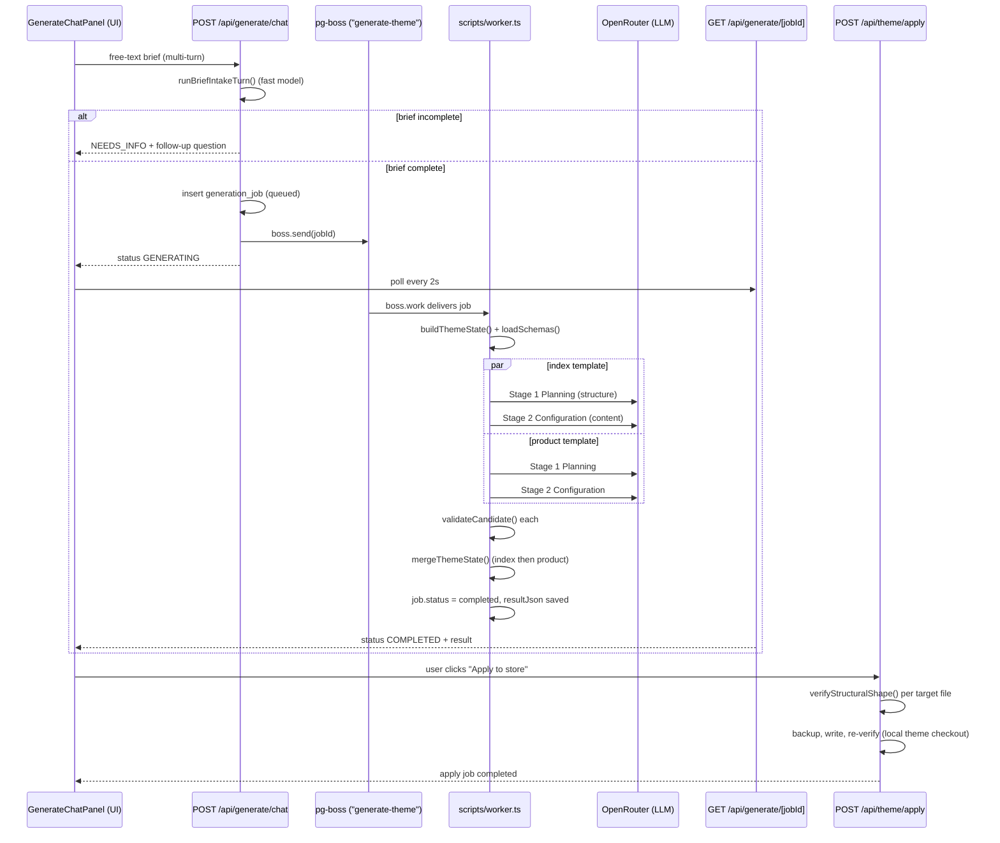

# Theme Generation Pipeline

How a merchant's chat prompt turns into a generated Shopify theme in `ai-schema-saas`.

## Overview

## Step by step

### 1. UI entry point
`components/generate-chat-panel.tsx` (`GenerateChatPanel`), mounted by `components/theme-workspace.tsx` whenever the org has no theme yet. The merchant types a free-text brand description; `handleSubmit` POSTs to the intake endpoint, accumulating a `sessionId` across turns — it's a chat, not a single form.

### 2. Intake turn — `POST /api/generate/chat` (`app/api/generate/chat/route.ts`)
- Auth + org-membership check, resolves the connected Shopify store.
- Loads/creates a `conversation_session` + `brief` row (`lib/ai-schema/generation-intake-session.ts`).
- Calls `runBriefIntakeTurn()` (`lib/ai-schema/brief-intake.ts`) — one AI call (uses `OPENROUTER_FAST_MODEL`) that extracts structured fields (`businessType`, `products`, `brandPersonality`, `visualDirection`, ...) into a `WebsiteBrief`, plus an optional follow-up question.
- `isIntakeComplete()` requires 4 turns elapsed OR `businessType` + 3 priority fields present. While incomplete, returns `NEEDS_INFO` and loops back to the UI.
- Once complete: inserts a `generation_job` row (`type: "initial_generation"`, `status: "queued"`) and enqueues it via **pg-boss** (`lib/queue.ts`, queue `"generate-theme"`).

### 3. Async worker — `scripts/worker.ts`
A standalone Node process (`npm run worker`) separate from the Next server; must be running or jobs sit queued forever. `processGenerateTheme`:
1. Marks job `"running"`.
2. `buildThemeState()` — snapshots the current theme's `templates/index.json`, header/footer sections, `settings_data.json` into the `theme_state` table.
3. `loadSchemas()` — reads the full section/block schema catalog from `lib/ai-schema/schema-data/`.
4. Runs `runStagedGeneration()` **twice in parallel** — once for `index`, once for `product` templates.
5. Validates each with `validateCandidate()`.
6. `mergeThemeState()` folds product's result onto index's (sequentially).
7. Writes `resultJson` (plans, configs, merged state, warnings, AI-call stats) and sets `status: "completed"`/`"failed"`.

### 4. AI generation — `lib/ai-schema/generation.ts`
Two bounded AI calls per template (not one mega-prompt):
- **Stage 1 (Planning)** — chooses section/block *types and order only*, from a template-eligible schema subset. A hero `slideshow` section is force-placed at position 0 deterministically. Validated by `validateGenerationPlan()`, with one automatic repair-retry call.
- **Stage 2 (Configuration)** — fills settings/content for exactly the approved structure. Validated by `validateOutput()` + `matchesPlan()` (no drift from the plan) + `validateCandidate()`. One repair-retry on failure.

Worst case: 2 templates × 2 stages × 2 attempts = up to **8 AI calls** per generation.

### 5. Models/provider
Everything routes through **OpenRouter** (`lib/ai-schema/ai-client.ts`, plain `fetch`), not a direct OpenAI/Anthropic SDK:
- `OPENROUTER_MODEL` (default `moonshotai/kimi-k2.5`) — planning, configuration, and AI color-palette generation.
- `OPENROUTER_FAST_MODEL` (falls back to the primary if unset) — brief-intake extraction only.
- Requests use `response_format: json_object`, `temperature: 0.8`.

### 6. Image generation — not active in this repo
No image generation happens here. `buildSystemPrompt()`/`buildConfigurationSystemPrompt()` explicitly instruct the model to leave every `image`/`image_picker` field as `""`, and `validateOutput()` rejects any AI-supplied image value that isn't a real `shopify://` or `https://` URL. (The `generateImages` toggle you may have seen recently is in the **separate** sibling project `Shopforge` — `lib/ai/config.ts` / `lib/ai/images.ts`, using `google/gemini-2.5-flash-image` via OpenRouter — unrelated to this pipeline.) `debutify-v9-scope.md` notes image generation as a known future gap here.

### 7. Job polling — `GET /api/generate/[jobId]` (`app/api/generate/[jobId]/route.ts`)
UI polls this every 2s; returns job status/result; org-membership enforced on every poll.

### 8. Apply to store — `POST /api/theme/apply` (`app/api/theme/apply/route.ts`)
A **separate, explicit, user-gated step** (the "Apply to store" button) — nothing auto-publishes. Calls `applyThemeState()` (`lib/ai-schema/apply.js`):
1. Computes target files from the merged theme state.
2. `verifyStructuralShape()` on each target JSON before writing anything.
3. Backs up current asset values, writes new ones, rolls back on partial failure, re-verifies post-write.

**Caveat:** `local-theme-fs.ts` writes to a **local filesystem theme checkout** (`LOCAL_THEME_ROOT`, vendored at `theme_base/theme/`), not the live Shopify Admin API — the custom app's access token lacks `read_themes`/`write_themes` scopes, so real Admin API calls would 403. `shopDomain`/`accessToken`/`themeId` are accepted for interface compatibility but ignored. Genuine Shopify publishing is not yet implemented (`app/api/shopify/install|callback` only handles OAuth store connection).

### Related: editing pipeline
Once a theme exists, `components/edit-chat-panel.tsx` → `app/api/edit/route.ts` → `lib/ai-schema/conversational-edit.ts`/`edit-pipeline.ts` → `app/api/edit/apply/route.ts` reuses the same schemas/validation/apply machinery for targeted edits. `ThemeWorkspace` switches between the generate and edit chats depending on whether a theme already exists.

## Data models (Drizzle ORM, `db/schema/`)
- `generation_job` — central job table: `type` (`initial_generation`|`targeted_edit`|`apply`), `status` (`queued`|`running`|`completed`|`failed`), `inputPrompt`, `resultJson`, `errorMessage`.
- `theme_state` — cached snapshot of a theme's current JSON per `(storeId, themeId)`.
- `conversation_session` — one row per intake/edit chat session.
- `brief` — accreting `WebsiteBrief` JSON, FK'd to `conversation_session`.
- `usage_counter` — per-org/period generation-count tracking.
- `shopify_store` — `shopDomain`, encrypted access token, `activeThemeId`.
